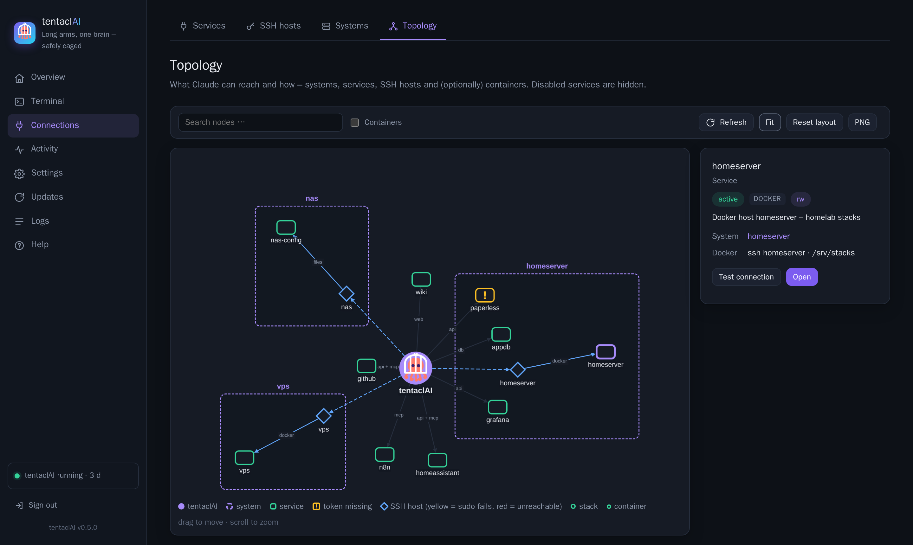
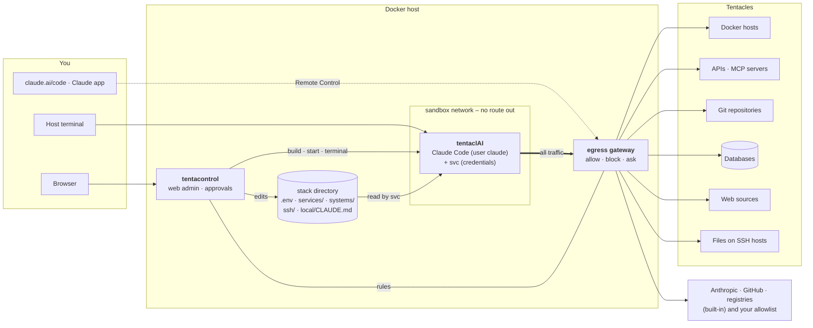
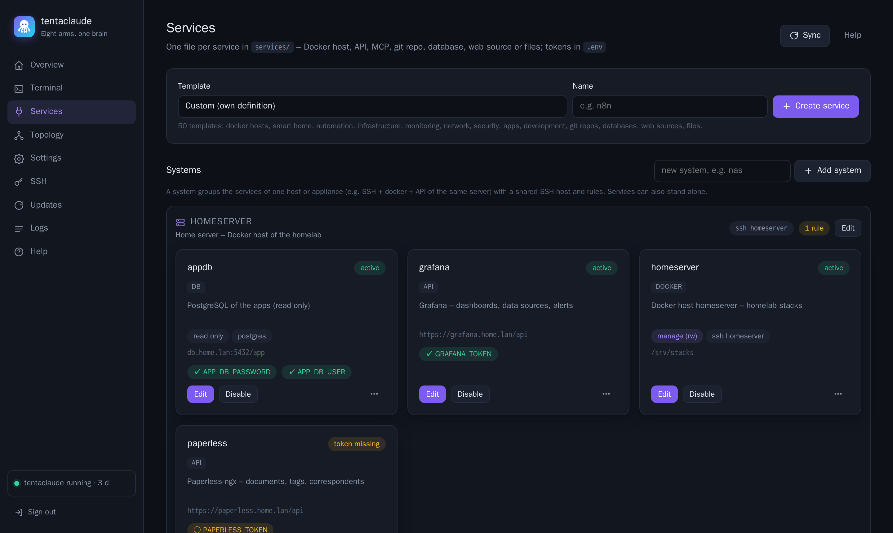

<p align="center">
  <picture>
    <source media="(prefers-color-scheme: dark)" srcset="docs/brand/wordmark-on-dark.png">
    
  </picture>
</p>

<p align="center"><strong>Long arms, one brain – safely caged.</strong><br>
Sandbox + service gateway for Claude Code.</p>

<p align="center">
  
  
  
  
</p>

tentaclAI runs [Claude Code](https://claude.com/claude-code) in its own container and gives it **controlled access to
your infrastructure** – Docker hosts, APIs, MCP servers, git repositories, databases, websites and files on other machines.
Every connection is a **service** you add on purpose, with its own access mode: read-only (`ro`), read-write (`rw`) or every write waits for your approval (`confirm`). A web admin,
**tentacontrol**, sets it all up, and you talk to Claude from the browser, from your phone or from the terminal.

<p align="center">
  
</p>

**Contents:** [Why](#why) · [How it works](#how-it-works) · [Getting started](#getting-started) ·
[Connecting a service](#connecting-a-service) · [Working with Claude](#working-with-claude) · [tentacontrol](#tentacontrol) ·
[Service reference](#service-reference) · [Configuration](#configuration) · [Security](#security) · [Roadmap](#roadmap)

---

## Why

Claude Code is great at operating systems – reading logs, fixing a compose file, querying an API, writing an automation.
Pointed at real infrastructure – servers, a homelab, company or cloud services – two questions come up immediately: *what may it touch?* and *how does it know
my setup?* tentaclAI answers both:

- **Explicit reach.** Claude sees nothing by default. Each Docker host, API, database or folder is connected as a service
  with an access mode – the `svc` tool in the container enforces it, and tokens never appear in commands or in Claude's context.
- **Built-in site knowledge.** A guided inventory and a per-service onboarding write down what your systems are for and what
  the rules are. Claude reads this on every start.
- **Always reachable.** A Remote Control session runs permanently – open it on claude.ai/code or in the Claude app (QR code
  in tentacontrol), or use the web terminal.

## How it works



**Tentacles** are everything Claude can reach: services (APIs, MCP servers, Docker hosts, databases, web sources,
files, git repos), SSH hosts and the systems that group them. You set them up in tentacontrol → *Tentacles*; each one
has its own access mode, and `svc` is the only way to use them. Everything else on the network is the job of the
egress gateway (tentacontrol → *Network*).

**Two layers of control.** `svc` decides *what* happens with a tentacle (it holds the credentials and enforces
`ro`/`rw`/`confirm`); the egress gateway decides *where* the sandbox may connect at all (built-in list, tentacles, your
allow/block lists – and in `enforce` mode it asks you about everything else).

The stack consists of **three containers** and one **stack directory**:

| Part | What it is |
|---|---|
| **tentaclAI** (container `tentaclai`) | The sandbox: Claude Code, `svc`, git, gh, docker CLI, database clients, tmux. Runs the permanent Remote Control session and holds your workspace (`/workspace`). Has **no** Docker socket, no host access and no route to the outside of its own – services go through `svc`, all traffic through the egress gateway. |
| **egress gateway** (container `tentaclai-egress`) | The sandbox's only way out: a small forward proxy (CONNECT for any port, plain HTTP; TLS is not opened). Allows the built-in list and your tentacles, applies your allow/block lists, records every destination and – in `enforce` mode – holds unknown destinations until you approve them in Activity. |
| **tentacontrol** (container `tentacontrol`) | The web admin: create and edit services, systems and SSH hosts, enter tokens, test connections, start onboarding, see the topology, open terminals into the sandbox, rebuild and update it. It uses the host's Docker socket only to run the tentaclAI container. |
| **`svc`** (inside tentaclAI) | The gateway Claude uses for every service: `svc <name> GET /path`, `svc docker`, `svc compose`, `svc db`, `svc web`, `svc files`, `svc git`. It runs as root (via sudo), injects credentials from `.env` at call time and enforces `ro`/`rw`/`confirm`; Claude itself runs as user `claude` and can't read `.env` or the SSH key. |
| **Services** (`services/<name>.json`) | One file per thing Claude may reach. A service can combine parts: `api`, `mcp`, `git`, `docker`, `db`, `web`, `files`. Secrets are `${VAR}` placeholders, the values live in `.env`. |
| **Systems** (`systems/<name>.json`) | Optional groups – e.g. *the NAS* = its SSH host + Docker + a database + an API – with a shared SSH host and rules that apply to every member. Services can also stand alone. |
| **SSH hosts** (`ssh/config.d/*.conf`) | Machines reachable with tentaclAI's own key, optionally with a sudo prefix for non-root users. Docker and file services use them. |
| **Site knowledge** | Claude's instructions are assembled on every start from generic rules, an optional host document, `local/CLAUDE.md` (your site rules) and generated tables of Docker and SSH hosts. A service catalog (`/workspace/SERVICES.md`) lists every service, system and rule. |

**Generic by design.** Code, templates and examples are the same for every installation. Everything site-specific lives in
`.env`, `compose.override.yaml`, `local/CLAUDE.md`, `services/`, `systems/`, `ssh/` and `data/` – all git-ignored.

## Getting started

Requirements: a Linux host with Docker (compose plugin) and a claude.ai account (Remote Control needs a claude.ai login,
an API key is not enough).

```bash
git clone https://github.com/mwaldegg/tentaclai.git /srv/stacks/tentaclai
cd /srv/stacks/tentaclai
./tentaclai.sh init        # guided: paths, domain, how to reach tentacontrol (port / nginx-proxy / Traefik),
                             # git identity, remote control, resources – then builds and starts tentacontrol
./tentaclai.sh setup-url   # one-time link to set the tentacontrol password
```

Then, in tentacontrol:

1. **Settings** – check paths, domain and git identity.
2. **Overview → Create & start** – builds and starts the tentaclAI container.
3. **Overview → Sign in now** – `claude auth login` in a web terminal; sign in with your claude.ai account.
4. **Overview → Remote Control** – scan the QR code or open the link; the session now shows up in claude.ai/code and the app.
5. **Tentacles → SSH hosts** – add the machines Claude should reach: host key check, key deployment with a one-time password, test – all in one dialog.
6. **Tentacles → Services** – connect your Docker hosts and services ([next section](#connecting-a-service)).
7. **Overview → System inventory** – Claude scans everything read-only, interviews you and writes `local/CLAUDE.md`.

Without a reverse proxy tentacontrol listens on `http://127.0.0.1:8484` (`CONTROL_BIND`, `CONTROL_PORT`).

**Updating:** `./tentaclai.sh update` – shows what's new and the upgrade steps, pulls, rebuilds and asks before recreating
the containers (`--check` only shows). tentacontrol also shows “Update available” in the sidebar.

## Connecting a service

<p align="center">
  
</p>

1. **Create from a template.** Tentacles → Services → search the template list (47 templates: Docker hosts, Home Assistant, Proxmox,
   Grafana, n8n, GitHub, PostgreSQL, wikis with login, folders on a NAS, …) → name → *Create service*.
2. **Fill in the details.** Adjust URL/host/path in the JSON editor; enter tokens under *Tokens & variables*. Tokens are
   write-only: they go into `.env` and are never shown again.
3. **Place it.** Put it into a system with the ⋯ menu (*Move to …*) or leave it standalone.
4. **Test connection.** `svc test` checks every part – HTTP status of the API, MCP endpoint, git remote, Docker version,
   database login, web login, folder on the SSH host – and tells you exactly what is missing.
5. **Onboard with Claude.** Opens a terminal with `/onboard <service>`: Claude tests the service, explores it **read-only**
   (API resources, tables, stacks, page structure …), summarizes what it found and asks you what the service is for, what it
   may do on its own, what only after asking and what never. It writes the answers – purpose, rules, examples – into the
   service file, so every later session knows them.

The service catalog for Claude and its instructions are regenerated on every change; new tokens work immediately.

**System inventory** (`/inventory`) is the counterpart for the whole site: `tc-scan` collects hosts, stacks, containers,
networks, services and SSH hosts read-only (never env files or secrets), Claude asks about purpose, criticality, backups,
taboos and conventions, and – after your approval – writes the result into `local/CLAUDE.md`. Run it again whenever the
setup changes; existing knowledge is kept.

## Working with Claude

| Where | How |
|---|---|
| **Phone / any browser** | Remote Control session (`claude-rc`), always running: claude.ai/code or the Claude app. |
| **tentacontrol → Terminal** | Web terminal into the sandbox: Claude in `/workspace`, the Remote Control session, a shell, onboarding/inventory sessions. Sessions run in tmux and survive closing the tab. |
| **Host terminal** | `./tentaclai.sh` (Claude), `./tentaclai.sh rc`, `./tentaclai.sh shell` (as user claude; `rootshell` as root), `./tentaclai.sh status`, `./tentaclai.sh update`. |

Inside the sandbox, Claude (and you) use:

```bash
svc list | info <name> | test <name>        # services, details, connection test
svc systems [name]                          # systems with SSH host, members and rules
svc <name> GET /path [curl args]            # API call, auth injected – tokens never in argv
svc docker <host> ps                        # docker CLI against a docker host (socket or SSH, sudo-aware)
svc compose <host> <stack> logs --tail 50   # compose in <stacks_dir>/<stack> of that host
svc db <name> "SELECT …" | tables           # databases (ro = read-only session)
svc web <name> /wiki/page | --links         # web pages as readable text, login handled by svc
svc files <name> ls|cat|grep|pull|diff|push # folders on SSH hosts; edit in /workspace/files/<name>
svc git | git sync [name]                   # repos in /workspace/repos (no credentials inside)
svc git push|pull|fetch <repo> [branch]     # through svc's mirror – access mode and approval apply
svc ssh <host> [command]                    # command or shell on an SSH host (status commands free, others need approval)
svc config put service <name> <file>        # Claude proposes a service file – always needs approval
svc pending                                 # approvals waiting in tentacontrol (also in Claude's status line)
# tab completion for all of these in the sandbox shells
tc-scan                                     # read-only inventory of all docker hosts, services, SSH hosts
```

Claude commands: **`/onboard <service>`** and **`/inventory`** (see above).

## tentacontrol

| Page | Purpose |
|---|---|
| **Overview** | Status of the sandbox (resources, Claude version, login, plan usage as bars), Remote Control with QR code and on/off switch, Docker and SSH hosts with live status, system inventory. |
| **Terminal** | xterm.js terminals into the sandbox (Claude, Remote Control, shell, login). Reconnects automatically. |
| **Tentacles** | Everything Claude can reach, in four tabs: **Services** (grouped by system, live status dot per service; templates, JSON editor, write-only tokens, connection test, onboarding, enable/disable, move between systems) · **SSH hosts** (live status; add with host key check and one-time password key deployment, edit incl. jump host, sudo and rename, remove with key revocation) · **Systems** (groups with SSH host and rules) · **Topology** (live graph incl. optional stacks/containers, search, saved layout, PNG export). |
| **Network** | Every destination the sandbox connected to (rule, last connection, filters), your allowlist and blocklist with one-click Allow/Block, the tentacles and the built-in list, and the switches *Mode* (permissive / enforce) and *IP targets* (ask / block) – see [Network control](#network-control). |
| **Activity** | Pending approvals – writes of `confirm` services (Approve / Approve + 15 min / Deny) and unknown network destinations (Allow 10 min / 1 h / Always / Deny / Block), badge in the sidebar and in Claude's status line – and the audit log of all write actions with filters. |
| **Settings** | All `.env` settings with descriptions; secrets are write-only. Shows *Apply now* when the sandbox must be recreated. Tab **Notifications**: channels (ntfy, webhook or any Apprise URL), which event goes where, quiet hours. Tab **Skills**: per skill of Claude Code and the account *On* / */command only* / *Off* (each listed skill costs context in every request; sandbox-useless ones start off). |
| **Updates** | Installed tentaclAI version, new releases with their upgrade steps (checked every 6 h, also shown in the sidebar; `UPDATE_CHECK=false` turns it off), Claude Code and image updates. |
| **Logs / Help** | Container log; full documentation of every feature. |

Single admin password (bcrypt), signed session cookie (12 h, SameSite=Strict), login throttling.
Reset: `./tentaclai.sh passwd`. tentacontrol itself is updated on the host: `docker compose up -d --build control`.

## Service reference

A service file can combine any of these parts:

```jsonc
{
  "name": "paperless",
  "description": "Paperless-ngx – documents",
  "system": "homeserver",                       // optional
  "api":    { "base_url": "https://paperless.home.lan/api",
              "auth": { "type": "header", "header": "Authorization", "value": "Token ${PAPERLESS_TOKEN}" } },
  "mcp":    { "type": "http", "url": "https://paperless.home.lan/mcp", "headers": { "Authorization": "Token ${PAPERLESS_TOKEN}" } },
  "notes":  ["Never delete documents."],
  "examples": ["svc paperless GET /documents/?page_size=5"]
}
```

| Part | Fields | Access control |
|---|---|---|
| `api` | `base_url`, `auth.type`: `none` · `bearer` · `header` · `basic` · `query` · `oauth2_client_credentials`; `insecure_tls`; `access` (default `rw`) | writes = everything but GET/HEAD/OPTIONS |
| `mcp` | like Claude's `.mcp.json`: `http`/`sse` (`url`, `headers`) or `stdio` (`command`, `args`, `env`) | the MCP server's own permissions |
| `git` | `url`, `access`, `auth` (token via credential helper) | `ro`: push blocked (pushurl + pre-push hook) |
| `docker` | `mode`: `socket` (`socket`, `stacks_dir`) or `ssh` (`ssh_host`, `stacks_dir`); `access` | `ro`: only read-only docker/compose commands |
| `db` | `engine` `postgres`/`mysql`, `host`, `port`, `database`, `user`, `password`, `ssl`; `access` | `ro`: read-only session, no shell |
| `web` | `base_url`, `auth.type`: `none` · `basic` · `bearer` · `header` · `form` (`login_url`, `fields`, `csrf_field`); `paths` | GET only, same host |
| `files` | `ssh_host` (or the system's), `path`, `sudo`; `access` | `ro`: no push; paths stay inside `path` |

**TLS:** internal services with your own CA → set `CA_CERT` (trusted by curl, git, python and node). For devices with self-signed
certificates, `"insecure_tls": true` in `api`, `web`, `git` or `db` (or the switch on the service page) skips certificate
verification for that part only – the connection stays encrypted. MCP connections are made by Claude Code and need `CA_CERT`.

**Access modes** (`access` in `api`, `docker`, `git`, `db`, `files`): `ro` refuses writes, `rw` allows them, `confirm` makes
every write wait for your approval in tentacontrol → **Activity** (denied or no answer within 10 minutes = not executed).
Every write through `svc` – and every blocked attempt – lands in the **audit log** (Activity, or `svc audit` in the sandbox);
secrets are never logged.

A part stays inactive while one of its `${VAR}`s is empty; `"enabled": false` parks the whole service.

**Rule of thumb:** a *service* is only needed for credentials or write access – public, read-only sources (docs, registries, public repos) just need an entry in tentacontrol → Network. One *service* = one way in with one set of credentials (an API and its MCP server may share a file);
one *system* = one machine or appliance that groups several services.
Systems: `systems/<name>.json` with `description`, `ssh_host`, `notes` (rules for every member) – see `systems/_example.json`.
SSH hosts: tentacontrol → Tentacles → SSH hosts, or `./ssh-host.sh list|add|sudo|hostkey|remove|test` (same logic, e.g.
`./ssh-host.sh add nas admin@nas.lan --jump gate --sudo`); jump hosts via `ProxyJump`; the sudo prefix is stored as
`# tentaclai: sudo=sudo -n` in the host block and needs passwordless sudo, ideally limited to what Claude needs.

## Configuration

| Variable (`.env`) | Meaning |
|---|---|
| `TC_DIR` | absolute host path of this stack (mounted under the same path) |
| `COMPOSE_FILE` | `compose.yaml:compose.generated.yaml:compose.override.yaml` |
| `DOCKER_SOCKET` | Docker socket of this host – for tentacontrol only |
| `HOST_DOCS` | optional Markdown file about the host, imported into Claude's instructions |
| `CA_CERT` | optional own root CA (PEM), trusted by curl, git, python and node in the sandbox |
| `TC_HOSTNAME`, `TC_DOMAIN` | name of this host for Claude; domain that prefills templates |
| `CONTROL_URL`, `CONTROL_BIND`, `CONTROL_PORT` | where tentacontrol is reachable |
| `CLAUDE_CPUS`, `CLAUDE_MEMORY`, `CLAUDE_CODE_VERSION` | sandbox resources, pinned Claude Code version |
| `GIT_USER_NAME`, `GIT_USER_EMAIL` | git identity of Claude's commits |
| `GH_TOKEN` | example token variable for the GitHub templates (`${GH_TOKEN}`) – no longer handed to `gh` in the sandbox |
| `RC_ENABLED`, `RC_NAME`, `RC_WORKDIR`, `RC_EXTRA_ARGS`, `RC_RESTART_DELAY` | Remote Control – re-read on every restart of the session |
| everything else | service credentials, referenced as `${VAR}` |

<details>
<summary>Repository layout</summary>

```
tentaclai/
├── compose.yaml               services claude (tentaclai) + control (tentacontrol)
├── compose.generated.yaml     socket/stacks mounts for local docker services (written by tentacontrol)
├── compose.override.*.yaml    site additions: reverse proxy, labels (example + your own)
├── .env.example               settings template (your .env: mode 600, git-ignored)
├── tentaclai.sh               host helper: init, Claude/RC/shell, status, inventory, passwd, setup-url
├── ssh-host.sh                SSH hosts on the command line (wraps tentacontrol-ssh – same logic as the UI)
├── lib/tclib.py               shared logic of both images: .env, ${VAR}, services, systems, SSH hosts
├── build/                     tentaclai image
│   ├── svc                    service gateway CLI
│   ├── tc-scan                read-only inventory
│   ├── claude-instructions    assembles Claude's CLAUDE.md (base rules + host docs + site rules + host tables)
│   ├── CLAUDE.base.md         generic rules for Claude
│   ├── commands/              /inventory, /onboard
│   └── entrypoint.sh, start.sh, rc-loop, cc
├── control/                   tentacontrol (FastAPI, HTMX, xterm.js, cytoscape.js – vendored, no CDN at runtime)
├── services/                  your services (git-ignored) + _template.json + _templates/ (47 templates)
├── systems/                   your systems (git-ignored) + _example.json
├── ssh/                       /root/.ssh of the sandbox (root only – used by svc): config, config.d/, keys/ (git-ignored)
├── local/                     CLAUDE.md with your site rules (template: CLAUDE.example.md)
├── data/                      Claude login (home), tentacontrol password hash and layout (git-ignored)
├── workspace/                 /workspace: projects, repos/, files/, SERVICES.md
└── docs/                      screenshots
```
</details>

## Network control

All traffic of the sandbox leaves through the egress gateway; tentacontrol → **Network** shows and controls it.

**Mode** – how the gateway treats a destination that no rule covers:

| Mode | Unknown destination |
|---|---|
| `permissive` (default) | allowed and recorded – use it to learn what the sandbox needs |
| `enforce` | held for up to 60 s while you decide in **Activity** (*Allow 10 min*, *Allow 1 h*, *Always*, *Deny*, *Block*); refused if nobody answers |

**IP targets** – connections to a bare IP address instead of a name (`curl https://93.184.215.14`). Normal programs
almost always use names, so in `enforce` mode such a connection without a rule is blocked (`block`, default) or asked
about like any other unknown destination (`ask`). `EGRESS_DIRECT_IP` in `.env`.

**Rules**, checked in this order:

1. **Built-in** – Anthropic (Claude Code, login, remote control), GitHub, PyPI, npm. Always allowed, can't be blocked.
2. **Blocklist** – always refused, even for tentacles.
3. **Your allowlist** – entries you added (Network tab, *Allow* on a seen destination, or *Always* in Activity).
4. **Tentacles** – hosts of your active services and SSH hosts, derived live (nothing to maintain).
5. **Temporary approvals** – *Allow 10 min* / *Allow 1 h*.

Entries: `host`, `*.domain` (subdomains only), an IP address or range (`10.0.0.0/8`), each optionally with `:port`.
The gateway resolves names itself and checks IP rules against the resolved address, so a blocked range can't be reached
through an allowed name. *Seen* lists every destination with its rule and last result (filters, **Clear**).

Claude Code's telemetry, error reports and `/bug` are off by default (`CLAUDE_TELEMETRY=true` turns them on).

## Security

What tentaclAI does:

- Claude reaches only what you connect; `svc` enforces `ro`/`rw`/`confirm` per service (docker/compose sub-commands, read-only DB
  sessions, blocked git push, no file push, same-host web fetches) and logs every write in the audit log.
- Credentials are injected at call time via environment or 0600 files on tmpfs – never in command lines, never shown in the UI.
- Claude's own permission prompts stay active; its rules tell it to ask before restarts, updates and deletions.

- **Privilege separation** in the sandbox: Claude runs as the unprivileged user `claude`. `.env`, the SSH key, the service
  files, git credentials and the audit log belong to root; Claude reaches them only through `svc` (via sudo), which enforces
  the access modes. Client tools (curl, psql, mariadb, stdio MCP servers) run as a third user `tcrun` with only the secret
  they need. MCP servers with tokens are proxied by `svc`, git pushes go through a root-owned mirror – Claude never sees a
  token or the private key, and can't change its own access modes (`svc config put` always needs your approval).

What it does **not** (yet) do – keep it in mind:

- An `rw` Docker host – or an SSH user with unrestricted sudo – is effectively **root on that machine**. A Docker service in
  `socket` mode is root on the tentaclAI host, and with it everything in the stack directory – prefer `ssh` mode.
- `tcrun` holds one secret at a time while a client runs: a shell escape in the interactive SQL shell (`\!`, approved
  separately in `confirm` mode) gets that user, its database password and the web cookie jars – not `.env` or the SSH key.
- **Egress gateway:** the sandbox has no route to the outside; all traffic goes through `tentaclai-egress`. `permissive`
  (default) allows and records everything; `enforce` allows only the built-in list, your tentacles and your allowlist and
  asks you about the rest. Allowed destinations are still ways out – what Claude may *do* there is up to `svc`.
- DNS is not filtered yet: the sandbox can still resolve names (a theoretical channel for data).
- tentacontrol holds the host's Docker socket – protect it with a strong password and keep it off the internet.
- `data/home` holds the Claude login and `ssh/keys` the private key – back them up and protect them.

## Roadmap

- **Security:** two-factor sign-in (TOTP) for tentacontrol · DNS filter in the egress gateway · read-only root filesystem,
  Docker socket proxy, prompt-injection safeguards
- **Automation:** scheduled Claude jobs (e.g. patch report, certificate expiry) with results as notifications
- **Export/import** of configuration and templates

## License

MIT – see [LICENSE](LICENSE). Contributions welcome, see [CONTRIBUTING.md](CONTRIBUTING.md) and the [Code of Conduct](CODE_OF_CONDUCT.md); security reports: [SECURITY.md](SECURITY.md).

## Notice

tentaclAI is an independent open-source project. It is not affiliated with, endorsed by or sponsored by Anthropic.
Claude and Claude Code are trademarks of Anthropic, PBC; they are used here only to describe what this project works with.
