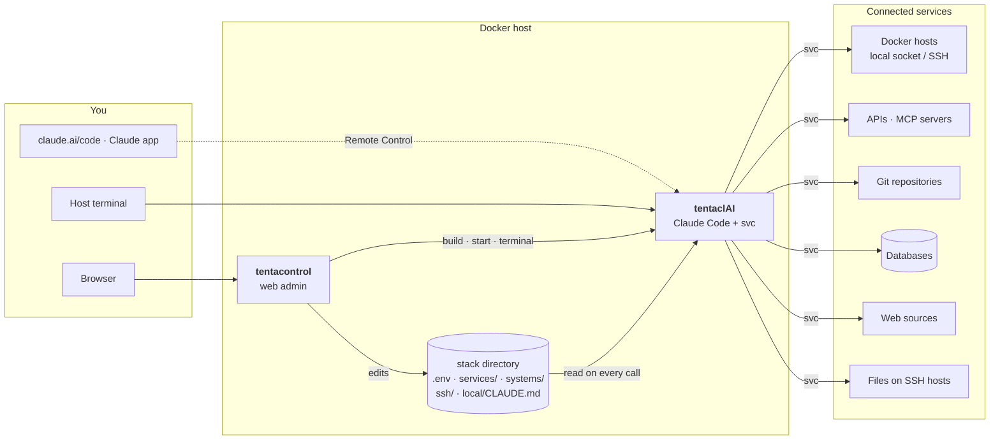

<p align="center">
  
</p>

<h1 align="center">tentaclAI</h1>

<p align="center"><strong>Eight arms, one brain.</strong><br>
Sandbox + service gateway for Claude Code.</p>

<p align="center">
  
  
  
</p>

tentaclAI runs [Claude Code](https://claude.com/claude-code) in its own container and gives it **controlled access to
your infrastructure** – Docker hosts, APIs, MCP servers, git repositories, databases, websites and files on other machines.
Every connection is a **service** you add on purpose, with its own rules (read-only or read-write). A web admin,
**tentacontrol**, sets it all up, and you talk to Claude from the browser, from your phone or from the terminal.

<p align="center">
  
</p>

**Contents:** [Why](#why) · [How it works](#how-it-works) · [Getting started](#getting-started) ·
[Connecting a service](#connecting-a-service) · [Working with Claude](#working-with-claude) · [tentacontrol](#tentacontrol) ·
[Service reference](#service-reference) · [Configuration](#configuration) · [Security](#security) · [Roadmap](#roadmap)

---

## Why

Claude Code is great at operating systems – reading logs, fixing a compose file, querying an API, writing an automation.
Pointed at a real homelab or server landscape, two questions come up immediately: *what may it touch?* and *how does it know
my setup?* tentaclAI answers both:

- **Explicit reach.** Claude sees nothing by default. Each Docker host, API, database or folder is connected as a service
  with an access mode – the `svc` tool in the container enforces it, and tokens never appear in commands or in Claude's context.
- **Built-in site knowledge.** A guided inventory and a per-service onboarding write down what your systems are for and what
  the rules are. Claude reads this on every start.
- **Always reachable.** A Remote Control session runs permanently – open it on claude.ai/code or in the Claude app (QR code
  in tentacontrol), or use the web terminal.

## How it works



The stack consists of **two containers** and one **stack directory**:

| Part | What it is |
|---|---|
| **tentaclAI** (container `tentaclai`) | The sandbox: Claude Code, `svc`, git, gh, docker CLI, database clients, tmux. Runs the permanent Remote Control session and holds your workspace (`/workspace`). Has **no** Docker socket and no host access of its own – everything goes through services. |
| **tentacontrol** (container `tentacontrol`) | The web admin: create and edit services, systems and SSH hosts, enter tokens, test connections, start onboarding, see the topology, open terminals into the sandbox, rebuild and update it. It uses the host's Docker socket only to run the tentaclAI container. |
| **`svc`** (inside tentaclAI) | The gateway Claude uses for every service: `svc <name> GET /path`, `svc docker`, `svc compose`, `svc db`, `svc web`, `svc files`, `svc git`. It injects credentials from `.env` at call time and enforces `ro`/`rw`. |
| **Services** (`services/<name>.json`) | One file per thing Claude may reach. A service can combine parts: `api`, `mcp`, `git`, `docker`, `db`, `web`, `files`. Secrets are `${VAR}` placeholders, the values live in `.env`. |
| **Systems** (`systems/<name>.json`) | Optional groups – e.g. *the NAS* = its SSH host + Docker + a database + an API – with a shared SSH host and rules that apply to every member. Services can also stand alone. |
| **SSH hosts** (`ssh/config.d/*.conf`) | Machines reachable with tentaclAI's own key, optionally with a sudo prefix for non-root users. Docker and file services use them. |
| **Site knowledge** | Claude's instructions are assembled on every start from generic rules, an optional host document, `local/CLAUDE.md` (your site rules) and generated tables of Docker and SSH hosts. A service catalog (`/workspace/SERVICES.md`) lists every service, system and rule. |

**Generic by design.** Code, templates and examples are the same for every installation. Everything site-specific lives in
`.env`, `compose.override.yaml`, `local/CLAUDE.md`, `services/`, `systems/`, `ssh/` and `data/` – all git-ignored.

## Getting started

Requirements: a Linux host with Docker (compose plugin) and a claude.ai account (Remote Control needs a claude.ai login,
an API key is not enough).

```bash
git clone https://github.com/mwaldegg/tentaclai.git /srv/stacks/tentaclai
cd /srv/stacks/tentaclai
./tentaclai.sh init        # guided: paths, domain, how to reach tentacontrol (port / nginx-proxy / Traefik),
                             # git identity, remote control, resources – then builds and starts tentacontrol
./tentaclai.sh setup-url   # one-time link to set the tentacontrol password
```

Then, in tentacontrol:

1. **Settings** – check paths, domain and git identity.
2. **Overview → Create & start** – builds and starts the tentaclAI container.
3. **Overview → Sign in now** – `claude auth login` in a web terminal; sign in with your claude.ai account.
4. **Overview → Remote Control** – scan the QR code or open the link; the session now shows up in claude.ai/code and the app.
5. **SSH** – add the machines Claude should reach (host key check + key deployment in one step).
6. **Services** – connect your Docker hosts and services ([next section](#connecting-a-service)).
7. **Overview → System inventory** – Claude scans everything read-only, interviews you and writes `local/CLAUDE.md`.

Without a reverse proxy tentacontrol listens on `http://127.0.0.1:8484` (`CONTROL_BIND`, `CONTROL_PORT`).

## Connecting a service

<p align="center">
  
</p>

1. **Create from a template.** Services → search the template list (50 templates: Docker hosts, Home Assistant, Proxmox,
   Grafana, n8n, GitHub, PostgreSQL, wikis with login, folders on a NAS, …) → name → *Create service*.
2. **Fill in the details.** Adjust URL/host/path in the JSON editor; enter tokens under *Tokens & variables*. Tokens are
   write-only: they go into `.env` and are never shown again.
3. **Place it.** Put it into a system with the ⋯ menu (*Move to …*) or leave it standalone.
4. **Test connection.** `svc test` checks every part – HTTP status of the API, MCP endpoint, git remote, Docker version,
   database login, web login, folder on the SSH host – and tells you exactly what is missing.
5. **Onboard with Claude.** Opens a terminal with `/onboard <service>`: Claude tests the service, explores it **read-only**
   (API resources, tables, stacks, page structure …), summarizes what it found and asks you what the service is for, what it
   may do on its own, what only after asking and what never. It writes the answers – purpose, rules, examples – into the
   service file, so every later session knows them.

The service catalog for Claude and its instructions are regenerated on every change; new tokens work immediately.

**System inventory** (`/inventory`) is the counterpart for the whole site: `tc-scan` collects hosts, stacks, containers,
networks, services and SSH hosts read-only (never env files or secrets), Claude asks about purpose, criticality, backups,
taboos and conventions, and – after your approval – writes the result into `local/CLAUDE.md`. Run it again whenever the
setup changes; existing knowledge is kept.

## Working with Claude

| Where | How |
|---|---|
| **Phone / any browser** | Remote Control session (`claude-rc`), always running: claude.ai/code or the Claude app. |
| **tentacontrol → Terminal** | Web terminal into the sandbox: Claude in `/workspace`, the Remote Control session, a shell, onboarding/inventory sessions. Sessions run in tmux and survive closing the tab. |
| **Host terminal** | `./tentaclai.sh` (Claude), `./tentaclai.sh rc`, `./tentaclai.sh shell`, `./tentaclai.sh status`. |

Inside the sandbox, Claude (and you) use:

```bash
svc list | info <name> | test <name>        # services, details, connection test
svc systems [name]                          # systems with SSH host, members and rules
svc <name> GET /path [curl args]            # API call, auth injected – tokens never in argv
svc docker <host> ps                        # docker CLI against a docker host (socket or SSH, sudo-aware)
svc compose <host> <stack> logs --tail 50   # compose in <stacks_dir>/<stack> of that host
svc db <name> "SELECT …" | tables           # databases (ro = read-only session)
svc web <name> /wiki/page | --links         # web pages as readable text, login handled by svc
svc files <name> ls|cat|grep|pull|diff|push # folders on SSH hosts; edit in /workspace/files/<name>
svc git | git sync [name]                   # repos in /workspace/repos (ro = push blocked)
tc-scan                                     # read-only inventory of all docker hosts, services, SSH hosts
```

Claude commands: **`/onboard <service>`** and **`/inventory`** (see above).

## tentacontrol

| Page | Purpose |
|---|---|
| **Overview** | Status of the sandbox (resources, Claude version, login), Remote Control with QR code and on/off switch, Docker and SSH hosts with live status, system inventory. |
| **Terminal** | xterm.js terminals into the sandbox (Claude, Remote Control, shell, login). Reconnects automatically. |
| **Services** | Services grouped by system; create from templates, JSON editor, write-only tokens, connection test, onboarding, enable/disable, move between systems. |
| **Topology** | Live graph of systems, services and SSH hosts; optional stacks and containers of every Docker host; search, movable nodes with saved layout, PNG export, details with actions. |
| **Settings** | All `.env` settings with descriptions; secrets are write-only. Shows *Apply now* when the sandbox must be recreated. |
| **SSH** | SSH hosts with live status, sudo prefix per host, add/remove with host key check and key deployment. |
| **Updates** | Claude Code and image updates (rebuild + recreate with a live log). |
| **Logs / Help** | Container log; full documentation of every feature. |

Single admin password (bcrypt), signed session cookie (12 h, SameSite=Strict), login throttling.
Reset: `./tentaclai.sh passwd`. tentacontrol itself is updated on the host: `docker compose up -d --build control`.

## Service reference

A service file can combine any of these parts:

```jsonc
{
  "name": "paperless",
  "description": "Paperless-ngx – documents",
  "system": "homeserver",                       // optional
  "api":    { "base_url": "https://paperless.home.lan/api",
              "auth": { "type": "header", "header": "Authorization", "value": "Token ${PAPERLESS_TOKEN}" } },
  "mcp":    { "type": "http", "url": "https://paperless.home.lan/mcp", "headers": { "Authorization": "Token ${PAPERLESS_TOKEN}" } },
  "notes":  ["Never delete documents."],
  "examples": ["svc paperless GET /documents/?page_size=5"]
}
```

| Part | Fields | Access control |
|---|---|---|
| `api` | `base_url`, `auth.type`: `none` · `bearer` · `header` · `basic` · `query` · `oauth2_client_credentials`; `insecure_tls` | read freely, writes only when asked (rules) |
| `mcp` | like Claude's `.mcp.json`: `http`/`sse` (`url`, `headers`) or `stdio` (`command`, `args`, `env`) | the MCP server's own permissions |
| `git` | `url`, `access`, `auth` (token via credential helper) | `ro`: push blocked (pushurl + pre-push hook) |
| `docker` | `mode`: `socket` (`socket`, `stacks_dir`) or `ssh` (`ssh_host`, `stacks_dir`); `access` | `ro`: only read-only docker/compose commands |
| `db` | `engine` `postgres`/`mysql`, `host`, `port`, `database`, `user`, `password`, `ssl`; `access` | `ro`: read-only session, no shell |
| `web` | `base_url`, `auth.type`: `none` · `basic` · `bearer` · `header` · `form` (`login_url`, `fields`, `csrf_field`); `paths` | GET only, same host |
| `files` | `ssh_host` (or the system's), `path`, `sudo`; `access` | `ro`: no push; paths stay inside `path` |

A part stays inactive while one of its `${VAR}`s is empty; `"enabled": false` parks the whole service.
Systems: `systems/<name>.json` with `description`, `ssh_host`, `notes` (rules for every member) – see `systems/_example.json`.
SSH hosts: `./ssh-host.sh add <alias> <user@host[:port]> [--sudo]` or tentacontrol → SSH; the sudo prefix is stored as
`# tentaclai: sudo=sudo -n` in the host block and needs passwordless sudo, ideally limited to what Claude needs.

## Configuration

| Variable (`.env`) | Meaning |
|---|---|
| `TC_DIR` | absolute host path of this stack (mounted under the same path) |
| `COMPOSE_FILE` | `compose.yaml:compose.generated.yaml:compose.override.yaml` |
| `DOCKER_SOCKET` | Docker socket of this host – for tentacontrol only |
| `HOST_DOCS` | optional Markdown file about the host, imported into Claude's instructions |
| `CA_CERT` | optional own root CA (PEM), trusted by curl, git, python and node in the sandbox |
| `TC_HOSTNAME`, `TC_DOMAIN` | name of this host for Claude; domain that prefills templates |
| `CONTROL_URL`, `CONTROL_BIND`, `CONTROL_PORT` | where tentacontrol is reachable |
| `CLAUDE_CPUS`, `CLAUDE_MEMORY`, `CLAUDE_CODE_VERSION` | sandbox resources, pinned Claude Code version |
| `GIT_USER_NAME`, `GIT_USER_EMAIL`, `GH_TOKEN` | git identity and GitHub access of the sandbox |
| `RC_ENABLED`, `RC_NAME`, `RC_WORKDIR`, `RC_EXTRA_ARGS`, `RC_RESTART_DELAY` | Remote Control – re-read on every restart of the session |
| everything else | service credentials, referenced as `${VAR}` |

<details>
<summary>Repository layout</summary>

```
tentaclai/
├── compose.yaml               services claude (tentaclai) + control (tentacontrol)
├── compose.generated.yaml     socket/stacks mounts for local docker services (written by tentacontrol)
├── compose.override.*.yaml    site additions: reverse proxy, labels (example + your own)
├── .env.example               settings template (your .env: mode 600, git-ignored)
├── tentaclai.sh               host helper: init, Claude/RC/shell, status, inventory, passwd, setup-url
├── ssh-host.sh                add/remove SSH hosts (config, host key, key deployment, sudo, test)
├── build/                     tentaclai image
│   ├── svc                    service gateway CLI
│   ├── tc-scan                read-only inventory
│   ├── claude-instructions    assembles Claude's CLAUDE.md (base rules + host docs + site rules + host tables)
│   ├── CLAUDE.base.md         generic rules for Claude
│   ├── commands/              /inventory, /onboard
│   └── entrypoint.sh, start.sh, rc-loop, cc
├── control/                   tentacontrol (FastAPI, HTMX, xterm.js, cytoscape.js – vendored, no CDN at runtime)
├── services/                  your services (git-ignored) + _template.json + _templates/ (50 templates)
├── systems/                   your systems (git-ignored) + _example.json
├── ssh/                       /root/.ssh of the sandbox: config, config.d/, keys/ (git-ignored)
├── local/                     CLAUDE.md with your site rules (template: CLAUDE.example.md)
├── data/                      Claude login (home), tentacontrol password hash and layout (git-ignored)
├── workspace/                 /workspace: projects, repos/, files/, SERVICES.md
└── docs/                      screenshots
```
</details>

## Security

What tentaclAI does:

- Claude reaches only what you connect; `svc` enforces `ro`/`rw` per service (docker/compose sub-commands, read-only DB
  sessions, blocked git push, no file push, same-host web fetches).
- Credentials are injected at call time via environment or 0600 files on tmpfs – never in command lines, never shown in the UI.
- Claude's own permission prompts stay active; its rules tell it to ask before restarts, updates and deletions.

What it does **not** (yet) do – keep it in mind:

- An `rw` Docker host – or an SSH user with unrestricted sudo – is effectively **root on that machine**.
- The sandbox runs as root and can read the stack directory, including `.env`. A secret broker is on the roadmap.
- tentacontrol holds the host's Docker socket – protect it with a strong password and keep it off the internet.
- `data/home` holds the Claude login and `ssh/keys` the private key – back them up and protect them.

## Roadmap

- **Security:** hardened sandbox (non-root, read-only root filesystem, egress allowlist, secret broker, Docker socket proxy,
  prompt-injection safeguards) · audit log of all write actions · access mode `confirm` (approve writes with a click)
- **Automation:** scheduled Claude jobs · monitoring per service with status and recommendations
- **SSH:** add and edit hosts completely in the UI
- **tentacontrol:** AI assistant for the configuration · OAuth with browser login · export/import of configuration and templates
- **Topology:** connections between systems and containers (reverse proxy → container, tunnels) · monitoring status
